While you will typically access Brand information directly within the context of a **Campaign** (which automatically presents the specific Brand tied to that campaign), there are times you need to view a brand's backend configuration.

To access global "setup" information about a Brand and its related Client, navigate to the **AD Brands** mapping from **GEN Clients**. Because a single Client can have multiple Brands associated with it, this mapping provides a complete overview of the Client's entire brand portfolio.

:::info

If your goal is to view or configure Brand setup details, starting your report with a bae mapping of **AD Brands** yis highly recommended.

:::

## Rep Assignments

Each Brand can have multiple Brand Reps assigned to it. There are three distinct assignment types, which allow you to customize who is assigned based on campaign specifics:

- **Default Brand Reps:** The standard representatives assigned to the brand globally.  

  > Exists in the **AD Internet Brand Product Reps** mapping. 

- **Product Override Brand Reps:** Representatives assigned automatically when a specific *Product* is used on a campaign (overriding the defaults). 

  > Exists in the **AD Internet Brand Product Reps** mapping. 

- **Product Group Override Brand Reps:** Representatives assigned automatically when a specific *Product Group* is used on a campaign (overriding the defaults).  

  > Exists in the **AD Internet Brand Reps** mapping.

### Assignment Rules & Scheduling

- **Capacity:** Each of the three assignment types listed above can support up to **four** assigned reps at a time.
- **Time-Based Scheduling:** You can schedule rep assignments in advance by defining a future date for them to become active.
- **Reporting:** All reports listed below will only display the reps that are *currently active* on the exact date the report is run.

:::tip

**Inactive Ind** - In both the **AD Internet Brand Reps** and **AD Internet Brand Product Reps** mappings there is a field **Inactive Ind** that indicates if a Rep has been disabled.  There are three options for this flag

- **Y** - Rep is disabled
- **N** - Rep is NOT disabled
- "" - If Blank, assume **N**, Rep is NOT disabled

NOTE that the 

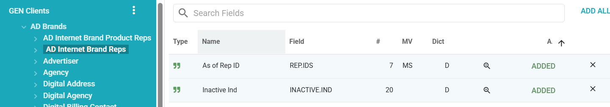

:::

### **Default Sales Reps Assignments for a Brand**

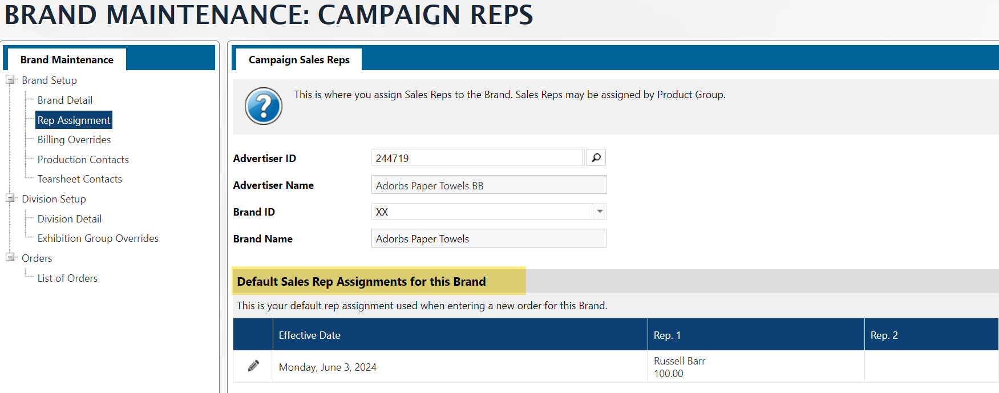

## Locating and Joining Default Reps

The **AD Brands** mapping does not contain a "Default Rep" field, nor is there a direct relationship between **AD Brands** and **AD Internet Brand Product Reps** for default reps.

Instead, default reps are stored exclusively in the **AD Internet Brand Product Reps** mapping. They are identified by a composite `Brand Product ID` structured exactly like this:

```
[Client ID (Name ID)]*[Brand ID]*Default
```

> **Example:** A default rep for Client `123` with Brand `XX` would have the ID `123*XX*Default`.

### The Solution: Create a Standalone Dataset

To include default reps in your reports, you must create a separate **dataset** that exclusively pulls default reps from **AD Internet Brand Product Reps**, and then join that dataset to your main report using the **Brand Key**.

To save time, you can use the pre-built template below. Because there may be multiple groups of default reps scheduled by date, this dataset includes logic to return only the most recent, currently active rep based on today's date.

:::tip Download

🔗 **[Download [JOIN\] Default Brand Rep Template](https://www.google.com/search?q=../report-library/join-default-brand-rep)**

:::

### How the Date Logic Works

The dataset evaluates the `asOfDate` to determine which rep is active. Here is an example scenario:

| **asOfDate**   | **asOfRep**  | **asOfRepPct** |
| -------------- | ------------ | -------------- |
| **2024-01-01** | REP-1, REP-2 | 50%, 50%       |
| **2024-06-15** | REP-2        | 100%           |
| **2024-06-25** | REP-3        | 100%           |
| **2024-06-30** | REP-2        | 100%           |

If today's date is **06/26/2024**, the dataset will return **REP-3** because 2024-06-25 is the most recent past date relative to today.

> **Technical Note:** The `asOfRep` and `asOfRepPct` fields are both multivalued and **subvalued** (effectively arrays within arrays). This nested structure exists because the `asOfDate` itself is multivalued: you can schedule multiple activation dates, and within *each* of those dates, you can assign up to four default reps along with their respective split percentages.

### Joining the Dataset to Your Report

The final step is to join this new default rep dataset to any report that requires it. You will make this join using the **Brand Key**.

For example, if you are building an Order report using **AD Internet Orders** as your base mapping, you need to route through the campaign mapping to establish the join:

1. Retrieve the **Brand Key** from the **AD Internet Campaigns** mapping.
2. Join the **[JOIN] Default Brand Rep** dataset to your report using that Brand Key as follows:

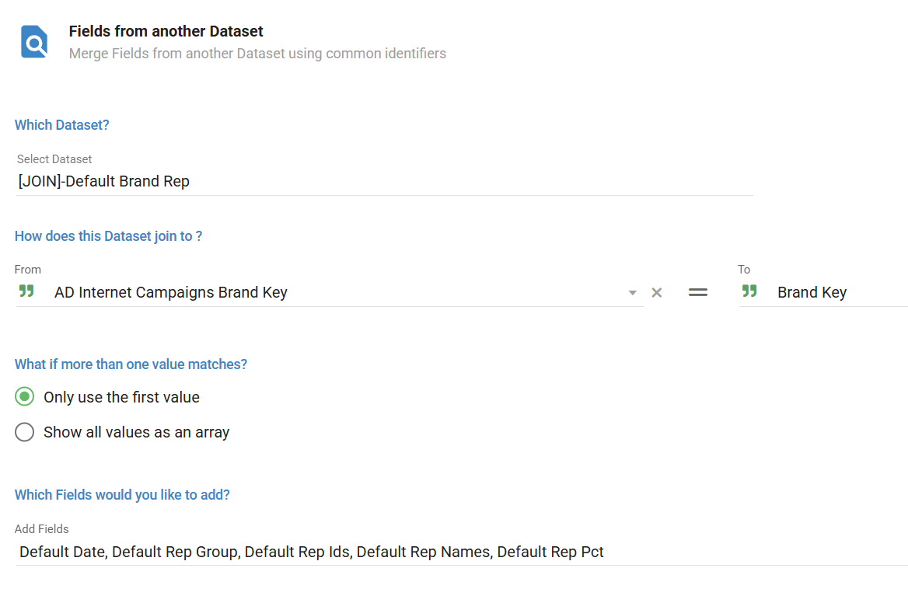

---

## Sales Rep Overrides by Product Group

The details for Rep overrides by Product Group are linked to the **AD Brands** mapping using the `BRAND.REP.KEY`. This key is a virtual field structured as follows:

```
[Client ID]*[Brand ID]*[Product Group ID]
```

To retrieve the actual override reps, you must use this key to pull the data from the **AD Internet Brand Reps** mapping.

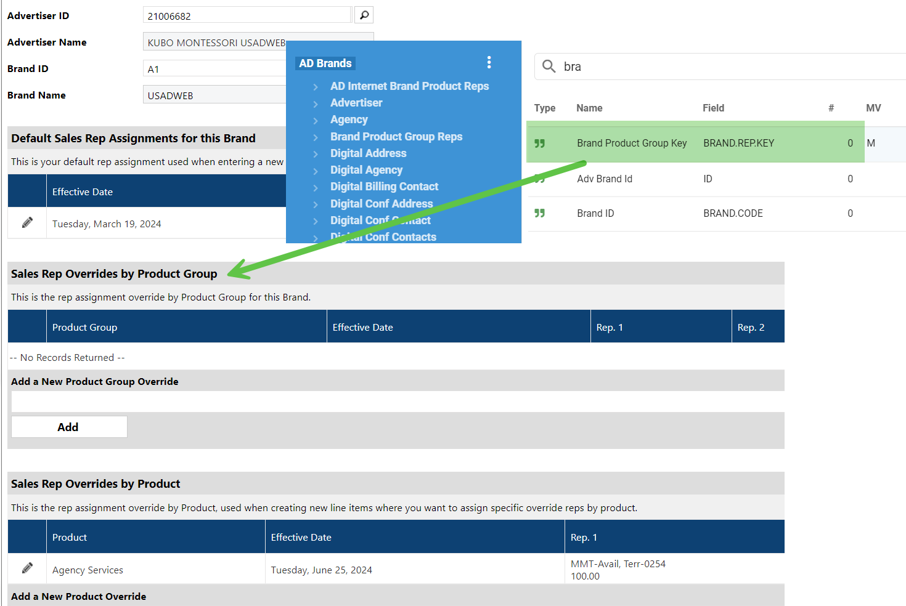


:::caution

Given that you have the ability to "schedule" reps, the table structure is a bit complex.  Given that, you will need to create a separate dataset to get Ad Brand Product Group reps.

Here is a template that will return the "Current" rep based on the date the report was run.


:::

:::tip Download

**[Download JOIN-AD Brand Product Group Reps](../report-library/join-ad-brand-product-groups)**

:::

---

## Sales Rep Overrides by Product

In the AD Brands mapping, the **BRAND.PRODUCT.REP.KEY**  will link to the **AD Internet Brand Product Reps** mapping.  This mapping will hold the information about the Product Rep overrides for a brand.

:::caution

The **AD Internet Brand Product Reps** mapping will hold all of the "Dates" for the override reps.  In Naviga you can schedule when reps are the active rep.  This means that you will need to extract the rep you are looking for.  If you are looking for the active rep based on today's date, you can use a function.  [Most Recent Date Function](#most-recent-date-function)

This is what the below dataset does to return just the "active" reps that are overrides for a Product on a Brand

:::

:::tip Download

**[Download JOIN-AD Brand Product Reps](../report-library/join-ad-brand-product-reps)**

:::


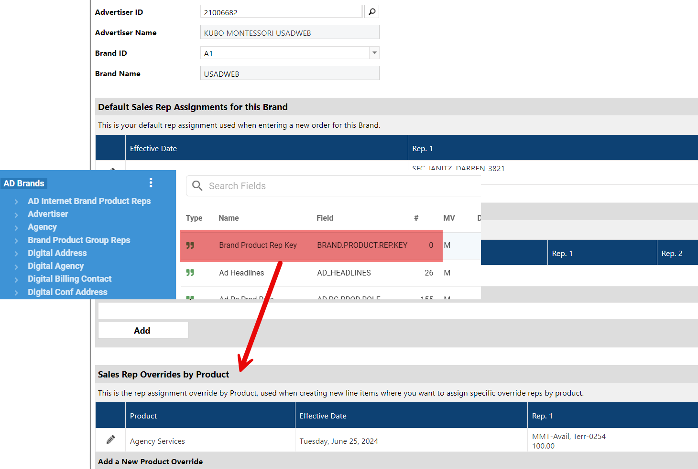

### Most Recent Date Function

```js
//------------------------------------------------------------
// Pass in an array of dates and get the INDEX returned
// of the date the is closest to but not greater than today
//------------------------------------------------------------
function getMostRecentDateIndex(asOfDates) {
    if (!Array.isArray(asOfDates)) return 0
    const today = moment();
    let mostRecentIndex = -1;
    let mostRecentDate = null;
    
    asOfDates.forEach((date, index) => {
        const momentDate = moment(date);
        if (momentDate.isSameOrBefore(today)) {
            if (!mostRecentDate || momentDate.isAfter(mostRecentDate)) {
                mostRecentDate = momentDate;
                mostRecentIndex = index;
            }
        }
    });
    
    return mostRecentIndex;
}
```

## Disabled Brand Reps

In **AD Internet Brand Product Reps** and **AD Internet Brand Reps** there is a field named **INACTIVE.IND**.  If this field has a **Y** in it, then the reps associated with that row are **Disabled**, if it is blank or has a N then it is active.

- **AD Internet Brand Product Reps** - **INACTIVE.IND <20>**
- **AD Internet Brand Reps**  - **INACTIVE.IND <20>**

## Billing Overrides

**Billing Contact**

The field **AD Brands** `DIGITALBILLING.CONTACT <141> `links to the **GEN Company/Individual Names** mapping, which is named "Digital Billing Contact" in the mapping relationship from **AD Brands**.  

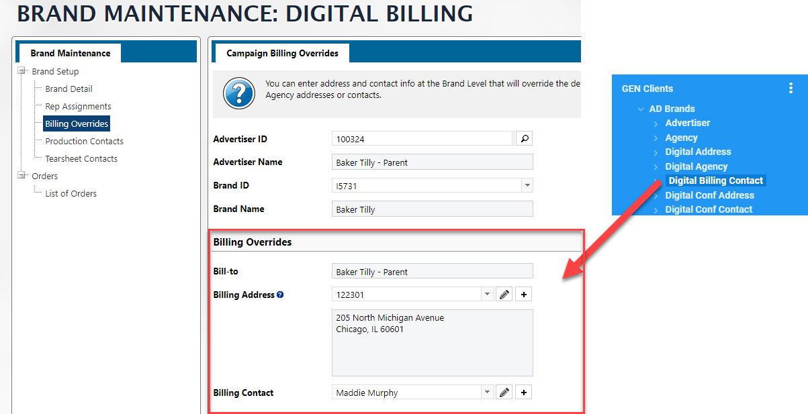

:::caution

You can get most of the information needed for the Billing Overrides in the **Digital Billing Contact** mapping, however, the billing address can be changed from the default.  Either way, the address that shows in the Billing Overrides section is in the field **DIGITAL.ADDRESS.ID <142>** in **AD Brands**.

The details for this address are located in the relationship called **Digital Address**

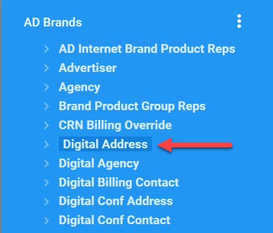

:::

**Invoice Email Contacts**

The Invoice Email Contacts for a given brand in the Billing Overrides section, is a multivalued field and links to the **GEN Company/Individual Names** mapping.

The field **AD Brands** `INET.INV.CONTACTS <203>` contains the IDs of the contacts.  As of the Q2-2022 release of the Informer Mappings, there is not a link to the detail information for this field.

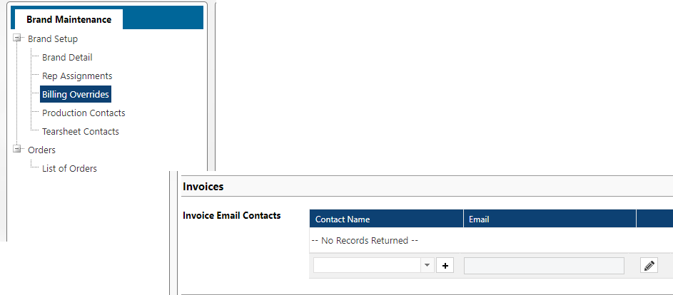

If you need this information, you will need to create a manual link in your datasource.  This can be done within Informer by using the following information when adding a new link to the **AD Brands** links

 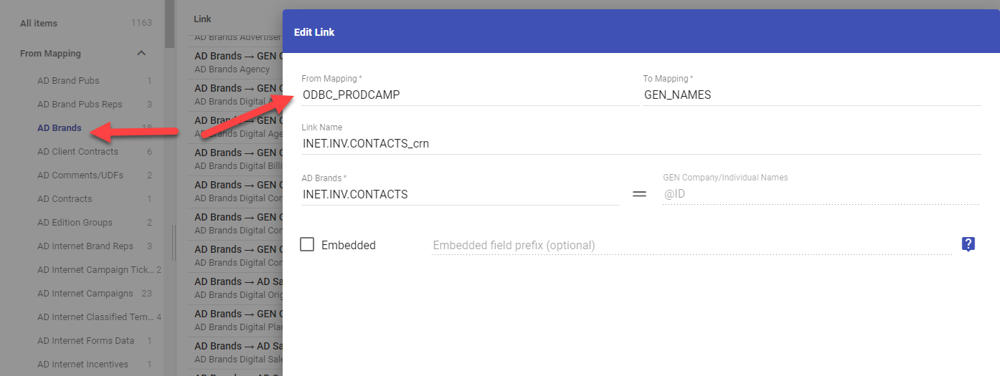

## PIB Codes

In the **AD Brands** mapping you will find the PIB Code in the **PIB_CODE <4>** field.

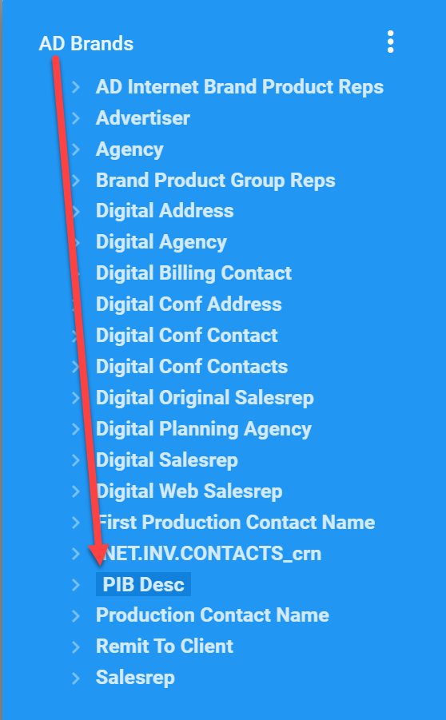

:::caution

You may also see a **PIB_CODE <101>** field in the **GEN Clients** mapping.  DO NOT USE this fields as it is not maintained. 

:::

## Brand Details Fields

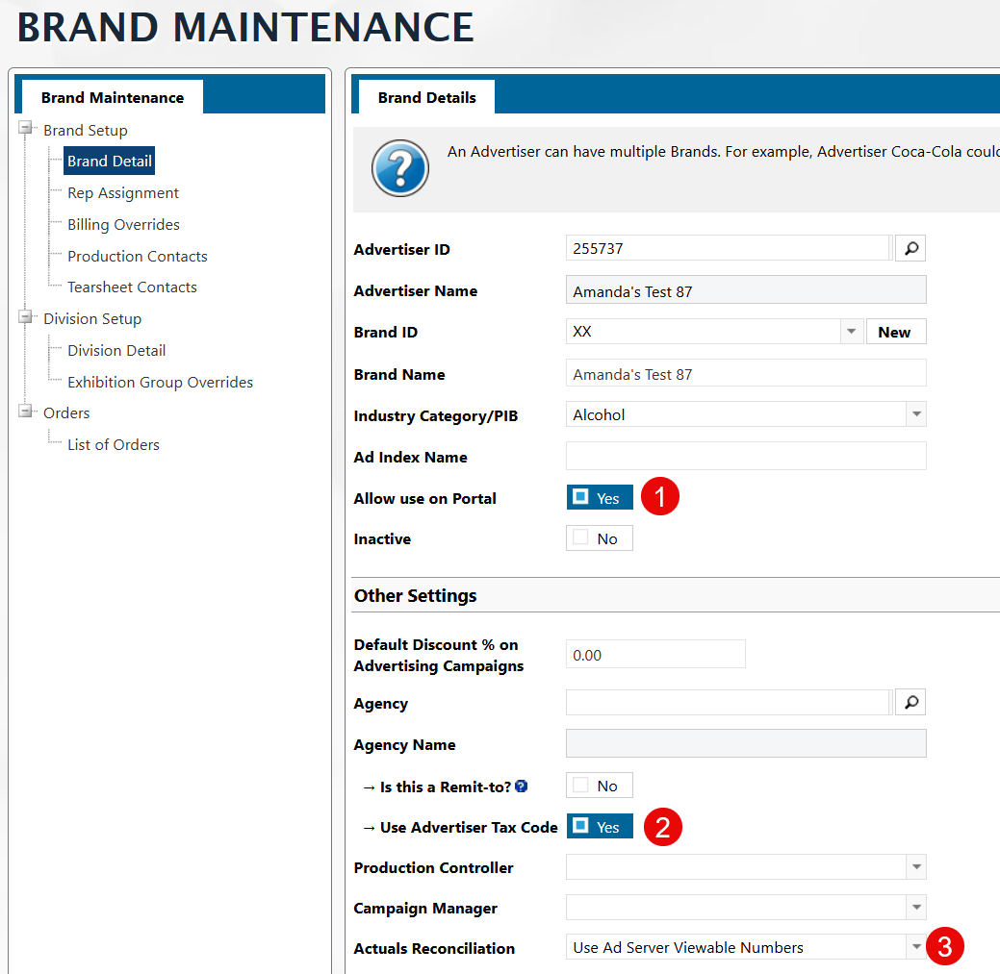

### 1.  DISALLOW.REMNANT.IND <165>

The DISALLOW.REMNANT.IND <165> field in AD Brands maps to the `Allow use on Portal` checkbox in the Naviga Ad Brand Maintenance screen `https://xxx.navigahub.com/EW/XXX/ad/setup/brand_detail`.

> This field is a bit confusing since the database field is **DIS**allow, but the checkbox is checking for Allowing the use.  This means that a "N" or Blank in the database would show as a checked "YES" in Naviga.
>
> And a "Y" in the database would show as a "No"/Unchecked box in Naviga

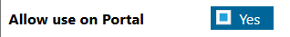 - If the Field is "N" or Blank

### 2.  USE.ADV.TAX.CODE.IND <211>

The USE.ADV.TAX.CODE.IND <211> field in AD Brands maps to the `Use Advertiser Tax Code` checkbox in the Naviga Ad Brand Maintenance screen `https://xxx.navigahub.com/EW/XXX/ad/setup/brand_detail`.

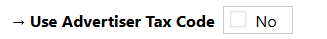 - If the field is "N" or Blank

### 3.  THIRD.PARTY.ACTUALS <167>

The THIRD.PARTY.ACTUALS <167> field in AD Brands maps to the `Third Party Actuals` checkbox in the Naviga Ad Brand Maintenance screen `https://xxx.navigahub.com/EW/XXX/ad/setup/brand_detail`.

> NOTE: You will want to test and verify that your values for the below items match what you expect.  TEST!

- **Use Company Defaults** = "" OR the letter for the default setting
-  **Use Third Party Number** = "Y"
-  **Use Estimates** = "E"
-  **Use Ad Server Numbers** = "N"
-  **Use Ad Server Viewable Numbers** = "V"
